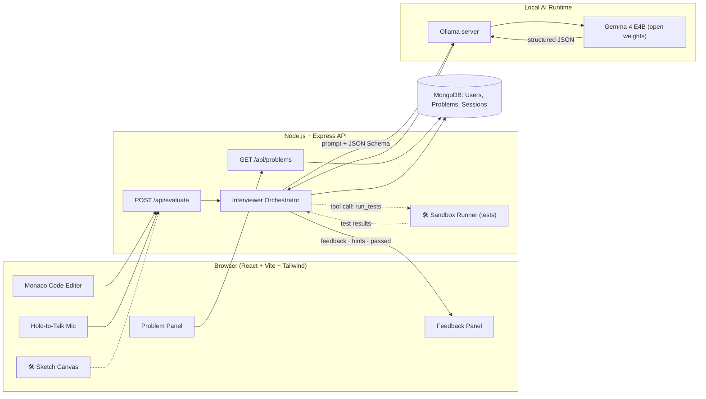
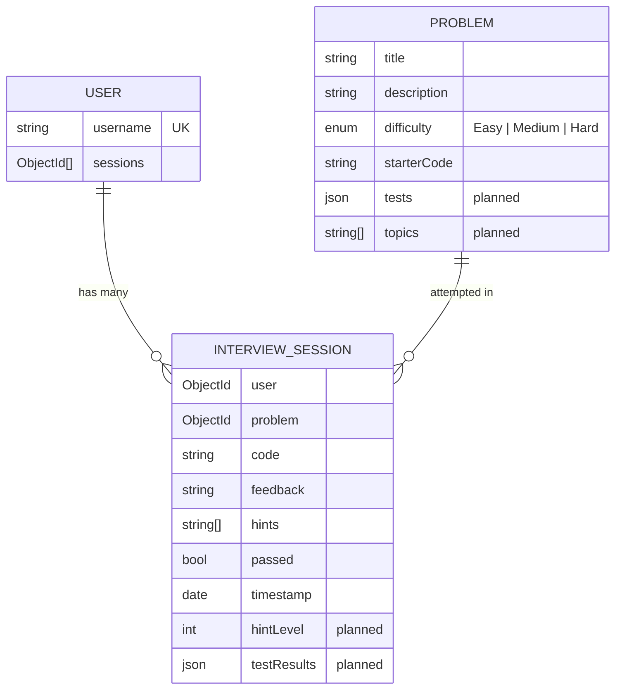
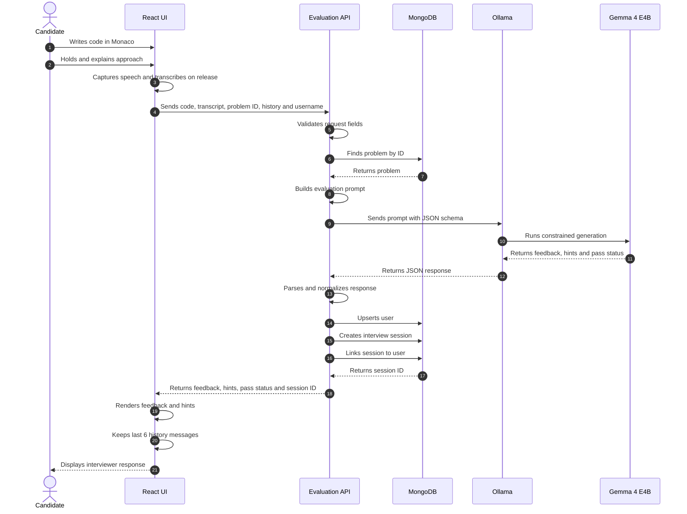
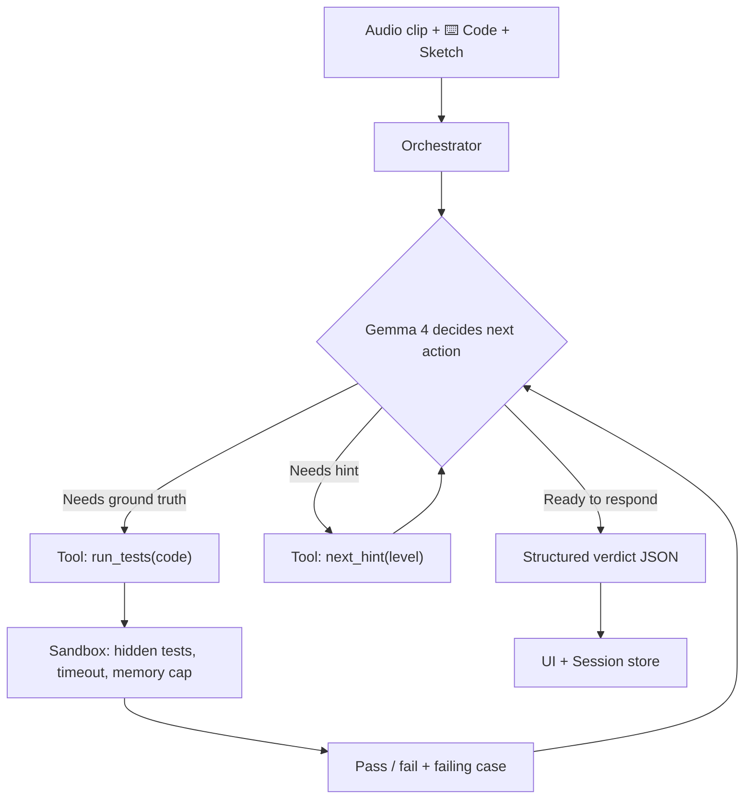
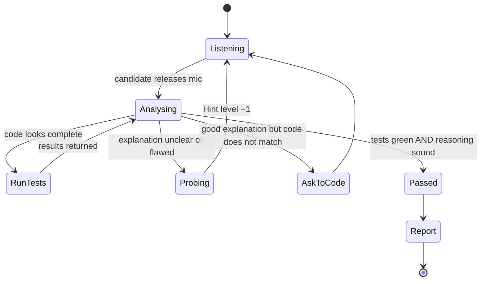

<div align="center">

# Whiteboard

### A fully local, voice-first AI technical interviewer powered by **Gemma 4**

*Think out loud. Code on the board. Get interviewed by an AI that gives hints, not answers, and keeps the model and your code on your own machine.*


-black?style=for-the-badge)


**Hacktober Fest | Open Source AI Hackathon | Organized by Elevate**
**Problem Statement 2: Best Use of Gemma 4 / Gemma 4 Open-Source**

**Team:** `Semicolon` &nbsp;|&nbsp; **Members:** `Palash Ahirwar`, `Parth Bhati`, `Jayesh Gupta`

</div>

---

## At a Glance

| | |
|---|---|
| **Problem** | Interview practice tools check code output but never test spoken reasoning; chatbot tutors reveal answers; cloud tools send voice and code to third parties. |
| **Solution** | A browser-based mock interviewer: the candidate writes code and explains it aloud, and a local Gemma 4 model replies with flaw-spotting questions and hints, never the answer. |
| **Model** | Gemma 4 E4B (open-weight, Apache 2.0) served locally through Ollama; no hosted model API, no API key. |
| **Already built** | Monaco editor, hold-to-talk voice input, Gemma 4 interviewer with schema-enforced JSON output, explanation-vs-code mismatch detection, multi-turn memory, MongoDB session history. |
| **Planned for the final** | Sandboxed test execution for grounded pass/fail, hint ladder, Gemma 4 native audio, skills report; stretch: sketch canvas with vision. |
| **Why it fits the track** | Gemma 4 is the core of the workflow: it reasons over code and speech together and produces the structured verdict. |

---

## Table of Contents

| # | Section | # | Section |
|---|---------|---|---------|
| 1 | [Project Name](#1-project-name) | 11 | [Component-Level Architecture](#11-component-level-architecture) |
| 2 | [Problem Statement](#2-problem-statement) | 12 | [Data / Information Flow](#12-data--information-flow) |
| 3 | [Project Overview](#3-project-overview) | 13 | [Agentic Workflow](#13-agentic-workflow-if-applicable) |
| 4 | [Proposed Solution](#4-proposed-solution) | 14 | [Technology Stack](#14-technology-stack) |
| 5 | [Objectives](#5-objectives) | 15 | [Expected Features](#15-expected-features) |
| 6 | [Target Users / Use Case](#6-target-users--use-case) | 16 | [Implementation Approach](#16-implementation-approach) |
| 7 | [Open-Source AI Technology Selected](#7-open-source-ai-technology-selected) | 17 | [Expected Final Output](#17-expected-final-output) |
| 8 | [Why This Technology Was Selected](#8-why-this-technology-was-selected) | 18 | [Future Scope / Scalability](#18-future-scope--scalability) |
| 9 | [AI's Role in the System](#9-ais-role-in-the-system) | 19 | [Open-Source Dependencies / Components](#19-open-source-dependencies--components) |
| 10 | [System Architecture](#10-system-architecture) | 20 | [Expected Challenges and Mitigation](#20-expected-challenges-and-mitigation) |

> **How to read this document:** Everything marked ✅ is **already built and working in our prototype**. Everything marked 🛠️ is **planned for the 10 October final** and scoped to be achievable in one hackathon day. We keep the two clearly separate on purpose.

---

## 1. Project Name

# **Whiteboard**
**Tagline:** *Practice the part of the interview nobody else lets you practice: explaining your thinking out loud.*

---

## 2. Problem Statement

Technical interviews test two skills at once: **writing correct code** and **communicating your reasoning while you do it**. Candidates can practise the first alone on platforms like LeetCode, but the second, which interviewers weigh heavily, has almost no good practice tool.

| Pain point | Reality today |
|---|---|
| **No one to practise with** | Mock interviews need a human, which means scheduling, cost and social pressure. For students in tier-2/3 cities, this access barely exists. |
| **Existing platforms are silent** | Online judges only check "does the output match?". They never ask *"why did you choose a hash map?"* or *"what is the time complexity?"* |
| **Chatbot tutors give away the answer** | Ask a generic LLM for help and it dumps the full solution, which defeats the purpose of interview practice. |
| **Cloud AI tools leak your data** | Voice recordings and code go to third-party servers. That is a privacy cost and also a recurring subscription and internet dependency. |
| **No structured feedback** | Candidates finish a practice session with no idea *what exactly* was weak in their explanation. |

**The gap:** there is no free, private, offline-capable tool that behaves like a real interviewer, listening to your voice, reading your code and nudging you without handing over the answer.

---

## 3. Project Overview

**Whiteboard** is a browser-based mock-interview environment. The candidate sees a coding problem, writes code in a Monaco (VS Code) editor, and **presses and holds a mic button to explain their approach out loud**. Whiteboard sends the **code + the spoken explanation + the conversation so far** to a locally running **Gemma 4** model, which responds the way a tough-but-fair interviewer would:

- it **spots logical flaws** in the reasoning or code,
- it **gives subtle hints** rather than the solution,
- it **notices when your explanation and your code disagree** and asks you to go back and write what you described,
- and it returns a **structured verdict** (feedback, hints, pass / not yet) that the UI renders instantly and the database stores for progress tracking.

The model, inference and storage run **on the user's own machine** via Ollama, with no API keys and no per-token cost. (Voice capture currently uses the browser's speech recognition; the final build moves it on-device, see §9 and §20.)

```
    You explain       ⌨️ You code             Gemma 4 (local)            You get
 ┌───────────────┐   ┌──────────────┐      ┌─────────────────────┐     ┌──────────────────┐
 │ "I'll use a   │ + │ function     │ ───▶ │ Reads code + speech │ ──▶ │ "What happens if │
 │ hash map for  │   │ twoSum(...)  │      │ + history, reasons  │     │  the complement  │
 │ O(n) lookup"  │   │ { ... }      │      │ like an interviewer │     │  is the same     │
 └───────────────┘   └──────────────┘      └─────────────────────┘     │  element?"       │
                                                                       └──────────────────┘
```

---

## 4. Proposed Solution

Whiteboard turns Gemma 4 into a **stateful, grounded, Socratic interviewer** instead of a chatbot. Four design decisions make it different from "an LLM with a text box":

| Design decision | What it means | Why it matters |
|---|---|---|
| **Code and speech together** | The model always sees *code and speech together*, never one without the other. | The core signal in an interview is the *mismatch* between what you say and what you wrote. |
| **Socratic system prompt with a "no direct answer" rule** | The interviewer persona is constrained to point out flaws and give subtle hints. | Preserves the learning value that generic chatbots destroy. |
| **Schema-constrained output** | Gemma 4's structured JSON output is enforced with a JSON Schema (`feedback`, `hints[]`, `passed`). | The UI never breaks on malformed text; every response is machine-readable and storable. |
| **Local-first** | Gemma 4 runs through Ollama on the user's laptop. | No per-token cost, offline-capable inference, and code stays on the user's machine. |

For the final round we extend this proven core with **grounded verification** (running the candidate's code against hidden tests so the pass/fail verdict is not purely the LLM's opinion), **Gemma 4's native audio and vision**, and a **post-interview skills report** (see §15 and §16).

---

## 5. Objectives

1. **Simulate a real technical interviewer** that evaluates *reasoning*, not just output.
2. **Never reveal the solution.** Guide with escalating hints (a hint ladder).
3. **Catch explanation-vs-code mismatch**, the single most realistic interviewer behaviour.
4. **Run locally** on consumer hardware with open weights (privacy, zero cost, offline-capable); fully on-device voice is a final-round goal. 🛠️
5. **Produce structured, storable output** so progress can be tracked across sessions.
6. **Ground the AI's verdict in real execution** so "passed" is trustworthy and not hallucinated. 🛠️
7. **Use Gemma 4's native multimodality** (audio and vision) as a core capability rather than a bolt-on. 🛠️
8. **Be genuinely useful** to the student community: free, private, shareable, extensible.

---

## 6. Target Users / Use Case

| Persona | Need | How Whiteboard helps |
|---|---|---|
| **Final-year students and campus-placement aspirants** | Practise explaining solutions before placements, with no mentor available | Unlimited free mock interviews, anytime, offline |
| **Career switchers / self-taught developers** | Confidence in verbal communication of code | Safe, judgement-free space to talk through problems |
| **Colleges, coding clubs, bootcamps** | A scalable, no-cost mock-interview lab | Self-host once on a lab machine; no per-seat licensing |
| **Privacy-conscious / low-bandwidth users** | Practice without uploading voice or code, or without reliable internet | Entire pipeline runs on-device |
| **Mentors and trainers** | See where a student struggles | Stored session history and (planned) skills report |

**Primary use case (walk-through):**
1. Candidate opens Whiteboard and picks a problem (e.g. *Two Sum*).
2. They write a first attempt in the editor.
3. They hold the mic and say: *"I'll loop through the array and, for each number, check every other number…"*
4. Gemma 4 replies: *"That works, but what is its time complexity? Can you avoid re-scanning the array?"* (**a hint, not the answer**).
5. They revise their explanation: *"I'll use a hash map to store what I've seen…"*, but the code still has the brute-force loops.
6. Gemma 4 notices the mismatch and says: *"Good idea. Now go ahead and write that on the whiteboard."*
7. They update the code, explain again, and get a ✅ **PASSED**.

---

## 7. Open-Source AI Technology Selected

### Primary model: **Google Gemma 4, `gemma4:e4b`** (open-weight, Apache 2.0)

| Attribute | Detail |
|---|---|
| **Model family** | Gemma 4 (Google DeepMind), released April 2026 as open-weight models in E2B, E4B, 26B-A4B and 31B sizes |
| **Variant used** | **E4B**, the small "effective 4B" edge-class model (≈4.5B effective parameters), light enough for a laptop |
| **License** | **Apache 2.0**: free for commercial and educational use, redistributable |
| **Context window** | 128K tokens on E4B, enough to hold the problem, code and long interview history |
| **Modalities (E4B)** | Text, image and **native audio** input, with text output |
| **Capabilities we use** | Coding and reasoning, **structured JSON output**, native function/tool calling (planned), multilingual understanding, audio understanding (planned), vision (planned) |
| **Serving** | **Ollama** local inference server (`/api/generate`, JSON-Schema-constrained `format`) |

### Supporting open-source components
**React + Vite, Monaco Editor, Tailwind CSS v4, Node.js / Express, MongoDB / Mongoose**, plus 🛠️ planned **whisper.cpp** (fallback speech-to-text) and **Excalidraw** (sketch canvas). Full list in [§19](#19-open-source-dependencies--components).

---

## 8. Why This Technology Was Selected

> *The choice was driven by the problem, not by popularity.*

An interviewer simulator has unusual requirements. Gemma 4 E4B is the best fit we found for **all of these requirements at once**:

| Requirement of the problem | Why Gemma 4 E4B fits |
|---|---|
| **Must understand code and reason about logic flaws** | Gemma 4 ships with strong coding and reasoning improvements; our prototype already uses it to critique candidate code |
| **Must output reliable structured data** (verdict, hints) | Native structured JSON output, which we enforce with a JSON Schema so the UI never receives malformed text |
| **Must handle spoken input** | **E4B includes a native audio encoder**, so speech can be understood *by the same model* (no separate STT pipeline needed in the final design) |
| **Must read hand-drawn diagrams** (system design / "whiteboard") | Native **vision input** lets the same model interpret a sketched tree, graph or architecture |
| **Must remember the whole conversation** | 128K context easily holds problem + code + multi-turn history |
| **Must run on a student laptop, offline** | E4B is an edge-class model; quantised builds run via Ollama on consumer GPUs and even capable CPUs |
| **Must be free and shareable** | Apache 2.0 licence: colleges can deploy it with no fee or API key |
| **Must be able to call tools** (run code, fetch hints) | Native function calling for an agentic loop |

### Why open-source (and why not a hosted API)?
| Concern | Hosted proprietary API | **Gemma 4 via Ollama (ours)** |
|---|---|---|
| Voice and code privacy | Sent to third-party servers | **Never leaves the device** |
| Cost at scale (a whole college) | Per-token billing | **₹0 marginal cost** |
| Works offline / low bandwidth | ❌ | ✅ |
| Interviewer behaviour control | Opaque, can change | **Pinned weights = reproducible** |
| Extensible (fine-tune on interview data) | Limited | ✅ LoRA possible |

### Why not a different open model?
| Alternative | Why Gemma 4 E4B was preferred for *this* problem |
|---|---|
| Larger open LLMs (Llama / Qwen / Mistral 7B-70B class) | Heavier hardware needs, which defeats the "runs on a student laptop" goal. Text-only variants would also need a separate speech and vision stack |
| Tiny SLMs (<2B) | Not reliable enough at critiquing code logic |
| Text-only coding models | No audio/vision, so we would need to stitch together 3 separate models |

---

## 9. AI's Role in the System

AI is **not an add-on; it is the product.** Remove Gemma 4 and Whiteboard has nothing left but an empty editor.

| AI responsibility | Description | Status |
|---|---|---|
| **Reasoning interviewer** | Reads problem, code, spoken explanation and history; identifies flaws in logic, complexity and edge cases | ✅ Built |
| **Hint generation (without leaking)** | Produces subtle, non-spoiling hints under a strict persona prompt | ✅ Built |
| **Explanation-vs-code consistency check** | Detects when a good verbal explanation is not yet reflected in code and asks the candidate to write it | ✅ Built |
| **Structured verdict** | Emits `{feedback, hints[], passed}` enforced by JSON Schema | ✅ Built |
| **Conversational memory** | Last turns of the interview are re-fed each request so follow-up questions are coherent | ✅ Built |
| **Native speech understanding** | Gemma 4 E4B consumes the raw audio clip directly, so it hears hesitation, pacing and emphasis that plain transcripts lose | 🛠️ Final |
| **Sketch understanding** | Interprets hand-drawn diagrams (trees, graphs, system designs) on a canvas | 🛠️ Final |
| 🛠️ **Tool use (function calling)** | Decides *when* to call `run_tests`, `get_next_hint_level`, `end_interview` | 🛠️ Final |
| **Skills report generation** | Summarises communication, correctness, complexity analysis and edge-case coverage at the end | 🛠️ Final |

---

## 10. System Architecture

### 10.1 High-level architecture


*Solid lines are implemented in the prototype. Dotted lines are the planned final-round extensions.*

### 10.2 Layered view

| Layer | Responsibility | Tech |
|---|---|---|
| **Presentation** | Problem view, code editor, voice capture, feedback display | React 18, Monaco, Tailwind v4 |
| **API / Orchestration** | Validation, prompt assembly, model call, persistence, response normalisation | Node.js, Express |
| **Intelligence** | Interviewer reasoning, hints, structured verdict | Gemma 4 E4B via Ollama |
| **Verification** 🛠️ | Ground-truth execution of candidate code against hidden tests | Isolated worker / VM sandbox |
| **Persistence** | Users, problems, interview sessions, history | MongoDB + Mongoose |

---

## 11. Component-Level Architecture

| # | Component | Responsibility | Interacts with | Status |
|---|---|---|---|---|
| 1 | **`ProblemPanel`** | Renders title, difficulty badge (Easy/Medium/Hard colour-coded) and the full problem statement with preserved formatting | `App` ← `/api/problems` | ✅ |
| 2 | **`Monaco Editor`** | VS Code-grade editing with syntax highlighting; loads each problem's starter code | `App` state | ✅ |
| 3 | **`HoldToTalkButton`** | Press-and-hold voice capture using Pointer Events (mouse, touch, pen); blocks the mobile long-press menu; auto-submits on release or when the pointer slides off | `useAudioRecorder` | ✅ |
| 4 | **`useAudioRecorder` hook** | Starts and stops continuous speech recognition and assembles the final transcript | Browser Speech API (current) → Gemma 4 native audio (final) | ✅ / 🛠️ |
| 5 | **`FeedbackPanel`** | Four UI states (idle, thinking, error, result); shows PASSED / NOT YET badge, feedback and  hints | `App` | ✅ |
| 6 | **`App` (state controller)** | Holds problem, code, result, chat history (rolling last 6 turns), loading and error state | all UI components, API | ✅ |
| 7 | **`routes/problems.js`** | Lists available problems | MongoDB | ✅ |
| 8 | **`routes/evaluate.js`** | Validates input → fetches problem → calls interviewer service → upserts user → saves session → returns result | `services/ollama.js`, models | ✅ |
| 9 | **`services/ollama.js`** | **Single point of contact with the model.** Builds the prompt, applies the system persona, forces schema output (temperature 0.2), parses and normalises the JSON | Ollama `/api/generate` | ✅ |
| 10 | **Models** (`User`, `Problem`, `InterviewSession`) | Persist users, problems with starter code, and every attempt with feedback, hints, verdict and timestamp | MongoDB | ✅ |
| 11 | **Seeder** | Idempotent upsert of starter problems | MongoDB | ✅ |
| 12 | **Hint Ladder Controller** | Tracks hint level per session (nudge → pointed → near-solution) and injects it into the prompt | Orchestrator, Session | 🛠️ |
| 13 | **Sandbox Test Runner** | Executes candidate code in an isolated worker with time/memory limits against hidden test cases | Orchestrator | 🛠️ |
| 14 | **Audio Capture → Gemma Audio Adapter** | Records mic audio, encodes it, sends to Gemma 4 for direct understanding | Orchestrator | 🛠️ |
| 15 | **Sketch Canvas** | Excalidraw canvas exported as an image for Gemma 4 vision | Orchestrator | 🛠️ |
| 16 | **Report Generator** | Produces an end-of-session skill scorecard | Sessions DB, Gemma | 🛠️ |

### 11.1 Data model



---

## 12. Data / Information Flow

### 12.1 End-to-end sequence (one interview turn)



### 12.2 Input → Processing → Output

| Stage | Data | Detail |
|---|---|---|
| **Input** | Code (text), explanation (voice → text now, raw audio in final), problem context, rolling history, *(final)* sketch image | Sent as one request |
| **Processing** | Prompt assembly, persona injection, schema-constrained Gemma 4 inference, JSON parsing and type normalisation | Low temperature (0.2) for a grounded, consistent interviewer |
| **Output** | `{ feedback: string, hints: string[], passed: boolean }` plus a persisted session record | Rendered in the UI and stored for analytics |

### 12.3 Final-round data flow (with grounded verification)



---

## 13. Agentic Workflow (if applicable)

Whiteboard's current loop is a single reasoning step. The final version becomes a **tool-using agent** built on Gemma 4's native function calling, with a **bounded loop** (max 3 tool calls per turn) to keep latency predictable.



### Agent definition

| Item | Definition |
|---|---|
| **Goal** | Determine whether the candidate genuinely understands the problem and can implement it, while teaching, not telling |
| **Persona** | "Tough but fair" Google-style interviewer who never states the answer |
| **Tools** | `run_tests(code)` → grounded pass/fail · `get_hint(level)` → next hint tier · `check_complexity(code)` → static loop/recursion heuristics · `end_interview(reason)` → finalise and trigger the report |
| **Memory** | Short-term: rolling conversation window ✅ · Long-term: past sessions in MongoDB for personalised follow-ups 🛠️ |
| **Decision policy** | Escalate the hint level only when the candidate is stuck for ≥2 consecutive turns · Mark `passed = true` only when **tests are green AND reasoning is sound** |
| **Guardrails** | Schema-enforced output · answer-leak check (output is screened for full-solution patterns) · bounded tool loop · sandbox time/memory limits |

### Hint ladder (anti-spoiler design)

| Level | Behaviour | Example (Two Sum) |
|---|---|---|
| **L0** | Probe: ask a question, nothing more | *"What is the complexity of your approach?"* |
| **L1** | Point at the weakness | *"You're scanning the array repeatedly. Is there information you could remember?"* |
| **L2** | Name the concept, not the code | *"Think about a data structure with O(1) lookups."* |
| **L3** | Describe the shape of the solution in words | *"For each number, what value would complete the sum, and have you seen it before?"* |

The model is **never** permitted to output the final code at any level.

---

## 14. Technology Stack

| Layer | Technology | Purpose | Status |
|---|---|---|---|
| **LLM** | **Gemma 4 E4B** (open-weight, Apache 2.0) | Interview reasoning, hints, verdict | ✅ |
| **Inference runtime** | **Ollama** | Local model serving, JSON-Schema-constrained generation | ✅ |
| **Frontend** | React 18 + Vite 6 | Component UI, fast dev server and proxy | ✅ |
| **Styling** | Tailwind CSS v4 | Responsive dark interview-room theme | ✅ |
| **Code editor** | `@monaco-editor/react` | In-browser VS Code editor | ✅ |
| **Voice input** | Web Speech API (current) → **Gemma 4 native audio** (final) | Capture explanation | ✅ / 🛠️ |
| **Backend** | Node.js (ESM) + Express 4 | REST API and orchestration | ✅ |
| **Database** | MongoDB + Mongoose 8 | Users, problems, sessions | ✅ |
| **Config** | dotenv + CORS | Environment-driven model and URL settings | ✅ |
| **Sandbox** 🛠️ | Node worker / isolated VM with timeouts | Safe execution of candidate code | 🛠️ |
| **Sketch canvas** 🛠️ | Excalidraw (MIT) | Hand-drawn diagrams to Gemma 4 vision | 🛠️ |
| **Fallback STT** 🛠️ | whisper.cpp (MIT) | Offline speech-to-text safety net | 🛠️ |

---

## 15. Expected Features

### ✅ Implemented in our working prototype

| # | Feature | Detail |
|---|---|---|
| 1 | **Two-pane interview workspace** | Left: problem and interviewer feedback. Right: Monaco editor and mic bar |
| 2 | **Problem bank with difficulty badges** | Seeded problems (*Two Sum*, *Valid Parentheses*) with starter code, loaded from MongoDB |
| 3 | **Live code editor** | Monaco (VS Code engine), dark theme, JS syntax highlighting |
| 4 | **Hold-to-Talk voice input** | Press-and-hold, release-to-submit; works with mouse, touch and pen |
| 5 | **Gemma 4 interviewer persona** | Tough-but-fair; flags logical flaws; gives subtle hints; never gives the answer |
| 6 | **Explanation-vs-code mismatch detection** | If the explanation is good but the code doesn't reflect it, the AI asks the candidate to write it on the board |
| 7 | **Schema-enforced JSON responses** | `feedback`, `hints[]`, `passed`, validated and type-normalised server-side |
| 8 | **Multi-turn conversation memory** | Rolling last-6-turn context so follow-ups are coherent without overloading the context window |
| 9 | **Clear verdict UI** | ✅ PASSED / ❌ NOT YET badge, written feedback and a dedicated  Hints list |
| 10 | **Full UX state handling** | Idle, "interviewer is thinking…" pulse, friendly error messages (backend down, no problems seeded) |
| 11 | **Persistent history** | Every attempt (code, feedback, hints, verdict, timestamp) is stored against the user |
| 12 | **Robust API validation** | Clear 400/404/500 errors for missing code, audio text or problem |
| 13 | **Config-driven model swap** | Change `OLLAMA_MODEL` or URL in `.env` to switch model size (e.g. E2B  E4B  26B) |
| 14 | **Large-payload ready backend** | 50 MB body limit, already prepared for audio payloads |
| 15 | **Idempotent seeding** | `npm run seed` upserts without duplicates |

### 🛠️ Planned for the 10 October final (priority-ordered)

| Priority | Feature | Why judges will care |
|---|---|---|
| **P0** | **Grounded verification:** run candidate code against hidden test cases in a sandbox; `passed` requires green tests *and* sound reasoning | Reduces LLM-hallucinated verdicts, a common weakness of AI-judge apps |
| **P0** | **Problem picker and more problems** (arrays, strings, stacks, hash maps, trees; 8-10 problems) | Makes the demo feel complete |
| **P0** | **Hint ladder (L0 to L3)** with a visible level indicator | Demonstrates the anti-spoiler design |
| **P1** | **Gemma 4 native audio:** send the recorded clip straight to the model, so speech is understood end-to-end on-device | Makes Gemma 4 central: one model hears, reads and reasons. Also removes the browser cloud-STT dependency, so the app is truly offline |
| **P1** | **Post-interview skills report:** radar of Correctness · Communication · Complexity Analysis · Edge Cases · Problem Solving, with 3 actionable tips | Gives students actionable takeaways |
| **P1** | **Streaming responses** | Faster perceived latency |
| **P2** | **Sketch canvas with Gemma 4 vision:** draw a tree, graph or architecture and the interviewer critiques it | Fits the "whiteboard" name and shows multimodality |
| **P2** | **Multi-language editor** (JS / Python / Java) and **interviewer modes** (Friendly, Standard, Tough) | Broader reach |
| **P2** | **Text-to-speech replies** using the browser's built-in voice | Hands-free, realistic interview feel |
| **P2** | **Progress dashboard** from stored sessions | Shows long-term progress |

---

## 16. Implementation Approach

### 16.1 What is already proven (de-risking)
The **core loop of the project (a local Gemma 4 interviewer with schema-enforced output, persistence and a voice-plus-code UI) is already built and running in our prototype.** The final hackathon is spent on extending a working base, not starting from zero. This is what makes our scope realistic.

### 16.2 Final-round build plan (10 October)

| Phase | Work | Output |
|---|---|---|
| **1. Warm-up** | Environment check: Ollama + Gemma 4 pulled and warmed, MongoDB seeded, prototype running on every teammate's machine | Stable baseline |
| **2. Grounding (P0)** | Add `tests[]` to the `Problem` schema; build the sandbox runner (worker thread, timeout, memory cap); wire results into the prompt and the `passed` rule | Trustworthy verdicts |
| **3. Interview intelligence (P0)** | Hint ladder state, problem picker UI, extra problems, answer-leak screen on model output | Core product complete |
| **4. Native audio (P1)** | Capture mic audio → send to Gemma 4 E4B → compare against Web-Speech transcript; keep the fallback | End-to-end on-device voice |
| **5. Report and polish (P1)** | Skills report, streaming, UI polish, error states | Demo-ready |
| **6. Stretch (P2)** | Sketch canvas and vision, TTS, extra languages, dashboard | "Wow" factor |
| **7. Evaluation and demo rehearsal** | Run the evaluation protocol (below), record fallback demo video, rehearse | Confident presentation |

### 16.3 Prompting and reliability strategy

| Technique | Purpose |
|---|---|
| **System persona prompt** | Fixes role, tone, and the "no direct answers" rule |
| **JSON-Schema constrained decoding** | Guarantees parseable output |
| **Low temperature (0.2)** | Consistent, grounded interviewer behaviour |
| **Rolling history window** | Coherence without overflowing context |
| **Tool-grounded verdict** | LLM explains; the sandbox decides correctness |
| **Server-side normalisation** | Frontend always receives correctly typed data |
| **Single model-gateway file** | All model logic lives in one service, so swapping models is a config change |

### 16.4 Evaluation plan (reproducible)
We will measure Whiteboard rather than just claim it works:

| Metric | How measured | Target |
|---|---|---|
| **Answer-leak rate** | Run a scripted set of "give me the answer" and stuck-candidate scenarios; count responses containing a full solution | ≈ 0 % |
| **Schema validity** | % of responses that parse and conform to the schema | 100 % (constrained decoding) |
| **Verdict accuracy** | Compare `passed` against hand-labelled correct and incorrect submissions for each problem | Report measured accuracy, with and without sandbox grounding |
| **Mismatch detection** | Hand-crafted cases where explanation ≠ code; check the AI asks the candidate to code | Report hit rate |
| **Turn latency** | Time from mic release to rendered feedback on a standard laptop | Report median (target: a few seconds on GPU) |

> We will publish the measured numbers in the final submission. We do not state results we have not measured.

### 16.5 Deployment / execution strategy
- **Run mode:** three local processes: `ollama serve` (Gemma 4), Express API, Vite UI, plus MongoDB (local or Atlas).
- **Setup:** `ollama pull gemma4:e4b` → `npm run seed` → `npm run dev` (backend and frontend).
- **Packaging (stretch):** a single `docker compose up` for API + Mongo + UI, with Ollama on the host.
- **Hardware floor:** a laptop with a modest GPU (or a capable CPU, with slower responses); `OLLAMA_MODEL` can be switched to **E2B** for weaker machines.
- **Repo:** public GitHub repository under an open-source licence (MIT for our code; Gemma 4 weights remain under Apache 2.0), as required by the challenge.

---

## 17. Expected Final Output

At the end of the final hackathon we will deliver:

1. ✅ A **working, demo-able web application** where an evaluator can pick a problem, code, speak, and receive a Gemma 4 interview in real time.
2. ✅ **Grounded verdicts**: pass/fail backed by real test execution plus AI reasoning review.
3. ✅ **Full local pipeline**: no cloud dependency for the model or storage, and on-device voice through the native-audio or whisper.cpp path.
4. ✅ **Structured JSON outputs** (`feedback`, `hints`, `passed`, test results) stored per session.
5. ✅ **Post-interview skills report** for the candidate.
6. ✅ **A public GitHub repository** with source, setup instructions, licence and a short evaluation write-up with measured results.
7. ✅ **A live demo + fallback recorded demo** clearly showing input → processing → model interaction → output.

**Demo script (3 minutes):**
`Pick "Two Sum"` → `write a brute-force solution` → `say it aloud` → `AI asks about complexity` → `candidate pivots to hash-map idea verbally` → `AI notices code mismatch, asks them to write it` → `candidate updates code` → `tests go green` → `✅ PASSED + skills report`.

---

## 18. Future Scope / Scalability

| Horizon | Direction |
|---|---|
| **Short term** | More problems and topics; DSA tracks by company; Python/Java/C++ support; mock "HR/behavioural" round using Gemma 4's conversational ability |
| **Multilingual** | Gemma 4 supports 140+ languages, so interviews can be practised in Hindi, Marathi, Tamil and others, which could improve accessibility for Indian students |
| **System-design rounds** | Candidate sketches an architecture on the canvas and Gemma 4 vision critiques scalability and bottlenecks |
| **Personalisation** | Long-term memory of weak topics; adaptive difficulty; spaced repetition of missed concepts |
| **Fine-tuning** | LoRA/QLoRA on curated interviewer dialogues to sharpen Socratic style and reduce leaks |
| **Retrieval (RAG)** | Embed a library of editorial hints and canonical approaches so hints are consistent and verifiable |
| **Institution mode** | Multi-user accounts, cohort dashboards, mentor view of student weak spots, **one lab server serving a whole classroom** |
| **Scaling the model** | Same code scales from **E2B (low-end) → E4B (default) → 26B-A4B / 31B** by changing one environment variable |
| **Deployment** | Dockerised on-prem deployment for colleges; optional PWA/offline desktop wrapper; Ollama request queueing for concurrent users |

**Extensibility by design:** all AI logic is isolated in one service, the problem bank is data-driven, and the persona is a prompt, so adding a new interview type (e.g. SQL, ML, behavioural) means adding data and a prompt, not rewriting the app.

---

## 19. Open-Source Dependencies / Components

| Component | Role | Licence |
|---|---|---|
| **Gemma 4 (E4B)** | Core model | Apache 2.0 |
| **Ollama** | Local model serving | MIT |
| **React 18** / **react-dom** | UI | MIT |
| **Vite 6** + `@vitejs/plugin-react` | Build tool and dev server | MIT |
| **Tailwind CSS v4** + `@tailwindcss/vite` | Styling | MIT |
| **@monaco-editor/react** (Monaco) | Code editor | MIT |
| **Node.js** | Runtime | MIT |
| **Express 4** | HTTP API | MIT |
| **cors** | Cross-origin handling | MIT |
| **dotenv** | Environment config | BSD-2-Clause |
| **Mongoose 8** | MongoDB ODM | MIT |
| **MongoDB** (Community) | Database | SSPL (server-side, used as a local service) |
| **nodemon** *(dev)* | Auto-reload | MIT |
| 🛠️ **Excalidraw** | Sketch canvas | MIT |
| 🛠️ **whisper.cpp** | Offline STT fallback | MIT |
| 🛠️ **Docker / Compose** *(stretch)* | Packaging | Apache 2.0 |

> Our own code will be released under an OSI-approved open-source licence (MIT) in the public final repository.

---

## 20. Expected Challenges and Mitigation

| # | Challenge | Risk | Mitigation |
|---|---|---|---|
| 1 | **LLM-hallucinated verdicts** (marking wrong code as passed) | High | Ground `passed` in sandboxed test execution; the LLM can only mark `passed` if tests are green |
| 2 | **Answer leakage:** model reveals the solution | High | Strict persona prompt + hint ladder + post-generation leak screen; evaluated with a scripted leak-test suite |
| 3 | **Latency on modest hardware** | Medium | E4B (edge-class) by default; fall back to E2B via config; streaming; bounded tool loop (≤3 calls); keep-alive model warm-up |
| 4 | **Native audio availability/limits in the local runtime** (audio support or clip-length limits may vary by serving stack) | Medium | Keep the existing speech-to-text path as a working fallback (Web Speech now, whisper.cpp offline); chunk long recordings; make audio path switchable by flag so the demo never breaks |
| 5 | **Browser speech recognition may use cloud processing** (it is Chrome-dependent and not fully private) | Medium | This is precisely why the final design moves to Gemma 4 native audio / whisper.cpp for a fully on-device pipeline |
| 6 | **Unsafe execution of candidate code** | High | Isolated worker with hard timeout and memory cap, no network or filesystem access, output truncation |
| 7 | **Small-model reasoning limits on hard problems** | Medium | Tool-grounded checking offloads correctness; curated problem set with known approaches; optional larger Gemma 4 (26B / 31B) on stronger machines |
| 8 | **Context growth over long interviews** | Low | Rolling 6-turn window (already implemented); summarise older turns if needed; 128K context gives ample headroom |
| 9 | **Inconsistent output formatting** | Low | JSON-Schema-constrained generation + server-side normalisation (already implemented) |
| 10 | **One-day scope creep** | Medium | Strict P0 → P1 → P2 ordering; the prototype already works end-to-end, so every phase adds value on a stable base; recorded fallback demo |
| 11 | **Noisy environments / accents hurting transcription** | Medium | Native audio model is generally more robust than plain STT; show the transcript so the user can see what was heard; push-to-talk limits noise capture |

---

<div align="center">

## How Whiteboard Maps to the Evaluation Criteria

| Judging criterion | How Whiteboard answers it |
|---|---|
| **Clarity of the problem** | Interview practice lacks a spoken-reasoning component; existing tools are silent, spoilery or cloud-bound |
| **Originality and relevance** | A *Socratic, voice-first* interviewer that detects explanation-vs-code mismatch, not another chatbot or API wrapper |
| **Technical depth and architecture** | Multi-tier system, schema-constrained generation, tool-grounded verification, bounded agent loop, sandbox |
| **Appropriate use and understanding of the open-source AI** | Gemma 4 E4B chosen for coding + structured output + native audio + vision + 128K context + edge size + Apache 2.0, each tied to a concrete requirement |
| **Meaningful integration of AI** | The model **is** the interviewer: reasoning, hints, consistency checks, verdicts, reports |
| **Feasibility within the final hackathon** | **A working prototype already exists**; the plan is incremental and priority-ordered |
| **Completeness** | All 20 sections, diagrams, data model, evaluation plan |
| **Impact, scalability, extensibility** | Free and private for students, deployable for a whole college lab, one-variable model scaling, multilingual path |
| **Overall coherence** | Each component maps to a requirement of the interview problem |

**Whiteboard: interview practice where you explain your thinking out loud.** 

</div>
